<p align="center">
  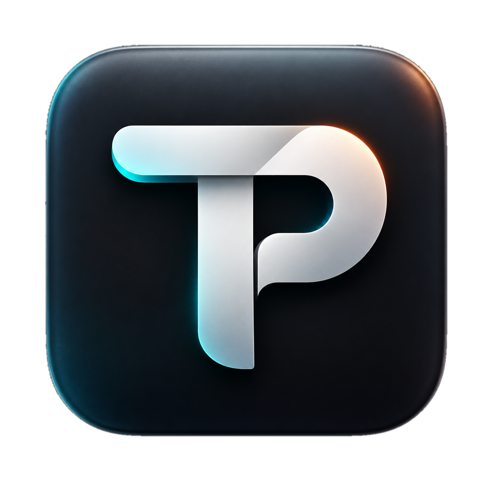
</p>

<h1 align="center">TikTok Poster</h1>

<p align="center">
  A desktop app for posting and scheduling <b>videos</b> and <b>photo carousels</b> to <b>TikTok</b> and <b>Instagram</b>,<br>
  using the official APIs. Runs on your Mac, and your keys stay on your machine.
</p>

<p align="center">
  
  
  
  
  <a href="https://github.com/abehan7/tiktok-poster/releases/latest"></a>
  <a href="LICENSE"></a>
</p>

<p align="center">
  <a href="https://github.com/abehan7/tiktok-poster/releases/latest"><b>⬇ Download for macOS</b></a>
</p>

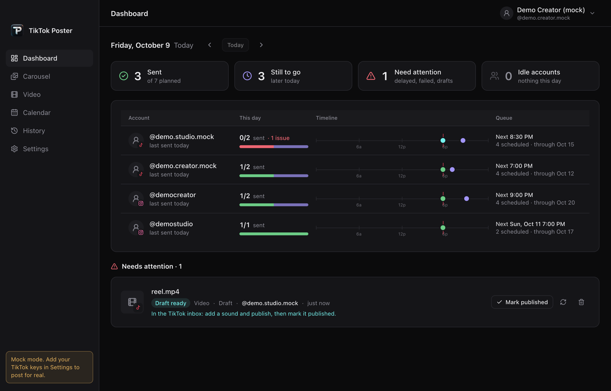

---

## Contents

- [Download](#download)
- [Features](#features)
- [Tour](#tour)
- [Quick start: try it in 2 minutes (no keys needed)](#quick-start-try-it-in-2-minutes-no-keys-needed)
- [Going live: connect real accounts](#going-live-connect-real-accounts)
  - [1. TikTok developer app](#1-tiktok-developer-app)
  - [2. Cloudflare R2 (for carousels and Instagram)](#2-cloudflare-r2-for-carousels-and-instagram)
  - [3. Instagram (optional)](#3-instagram-optional)
- [Using the app](#using-the-app)
- [Build a standalone .app](#build-a-standalone-app)
- [Where your data lives](#where-your-data-lives)
- [Troubleshooting](#troubleshooting)
- [How it works (for developers)](#how-it-works-for-developers)
- [Contributing](#contributing)
- [License](#license)
- [Disclaimer](#disclaimer)

---

## Download

Grab the latest DMG from the [Releases page](https://github.com/abehan7/tiktok-poster/releases/latest):

| Your Mac | File |
| --- | --- |
| Apple Silicon (M1 or newer) | `TikTok-Poster-<version>-arm64.dmg` |
| Intel | `TikTok-Poster-<version>-x64.dmg` |

Open the DMG and drag **TikTok Poster** into **Applications**.

The app isn't code-signed, so the first time you open it macOS may say it can't verify the developer. **Right-click the app → Open → Open** once, or run:

```bash
xattr -dr com.apple.quarantine "/Applications/TikTok Poster.app"
```

The app starts in mock mode, so you can look around before adding any keys. See [Going live](#going-live-connect-real-accounts) when you're ready to post for real.

---

## Features

- **Post photo carousels** (up to 35 slides) and **videos** (up to 4 GB) to TikTok.
- **Post to Instagram as well**: carousels (up to 10 slides) and Reels, from the same form.
- **Two TikTok modes:**
  - **Direct post** publishes straight to your profile.
  - **Draft to inbox** sends the post to the TikTok app, where you add a sound and publish from your phone.
- **Scheduling.** Pick a date and time and the app posts it for you, as long as it's running. Closing the window is fine.
- **Multiple accounts.** Connect several TikTok and Instagram accounts and choose which one to post as.
- **Dashboard, Calendar and History** show what went out, what's next, and what needs your attention.
- **Mock mode.** With no keys set, the app runs against a built-in fake TikTok and Instagram, so you can try everything safely.
- **Load a folder of slides.** Point it at a folder of numbered images plus a `caption.txt`, and the carousel fills itself in.
- **Bulk scheduling** by dropping a JSON file into an import folder.
- **Private by design.** Secrets and tokens are encrypted with the macOS Keychain (Electron `safeStorage`). The only servers the app talks to are TikTok, Instagram, and your own R2 bucket.
- Light and dark mode that follows macOS.

---

## Tour

### Dashboard

Your day at a glance: how many posts went out, what's still to come, and anything that needs a decision. Each connected account gets a row with a timeline of the day.


### New photo carousel

Add images or load a folder of slides. Click a slide to make it the cover.

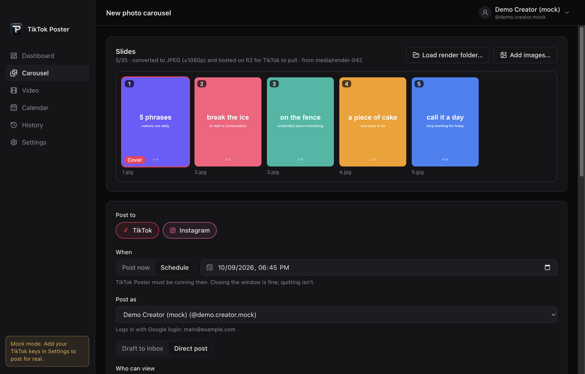

Choose **Draft to inbox** or **Direct post**, who can view it, and the title and description. You can also turn on auto-added music.

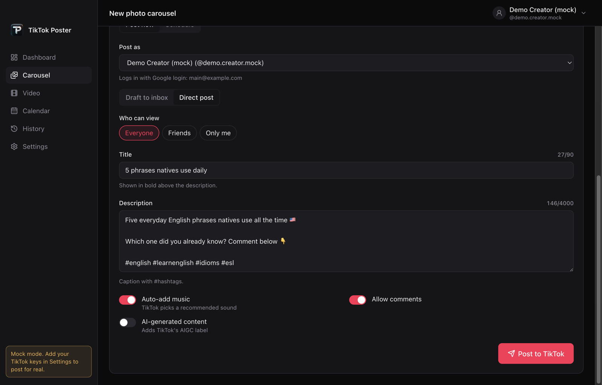

Turn on **Instagram** under *Post to* to publish the same slides to Instagram at the same time. If you leave the Instagram caption empty, it uses the TikTok description.

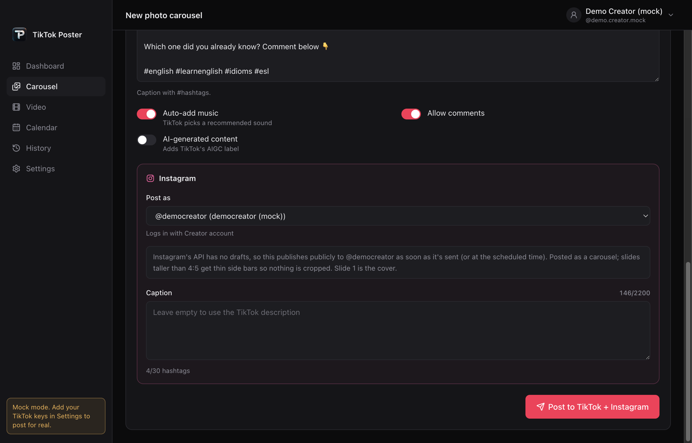

### New video

Drop in a video, scrub to a frame, and click **Use current frame** to set it as the cover. Post it to TikTok, Instagram Reels, or both.

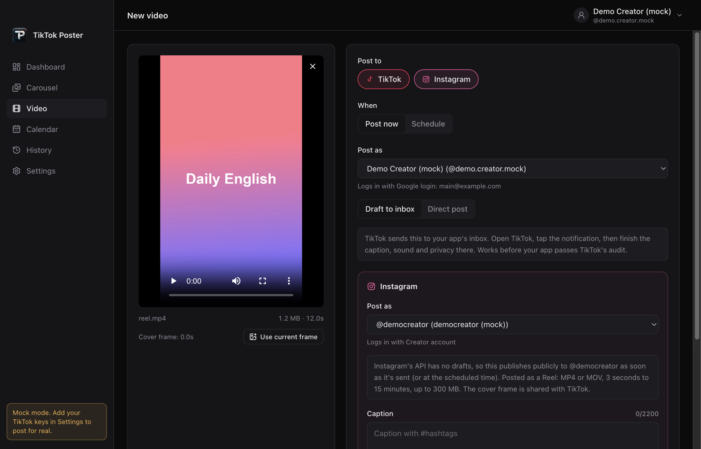

### Calendar

A month view of every scheduled and sent post. Filter by account, and click a day to see its posts. The cards at the top count anything that's delayed, failed, or still a draft.

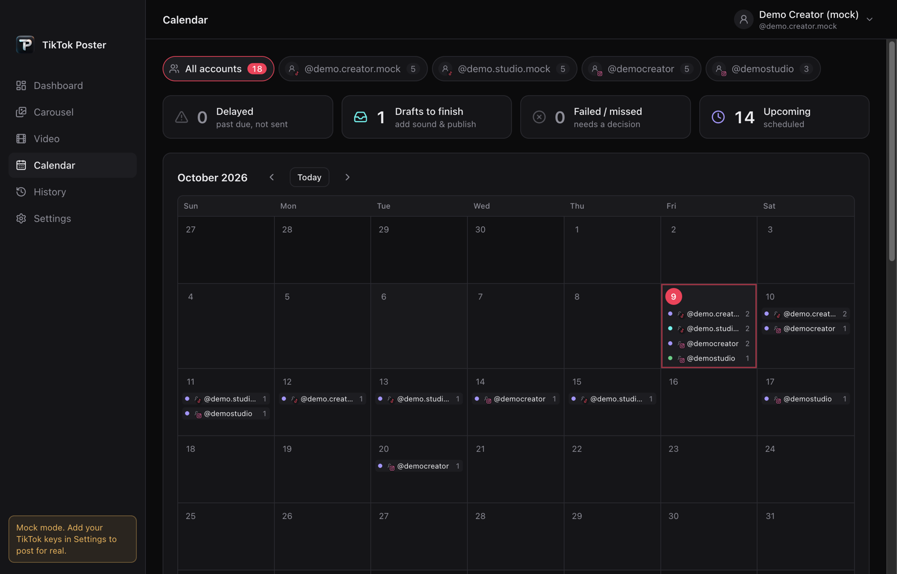

### History

Every post, grouped by account. Scheduled posts can be **posted now**, **rescheduled** or **cancelled**. Drafts can be **marked published** once you finish them in the TikTok app.

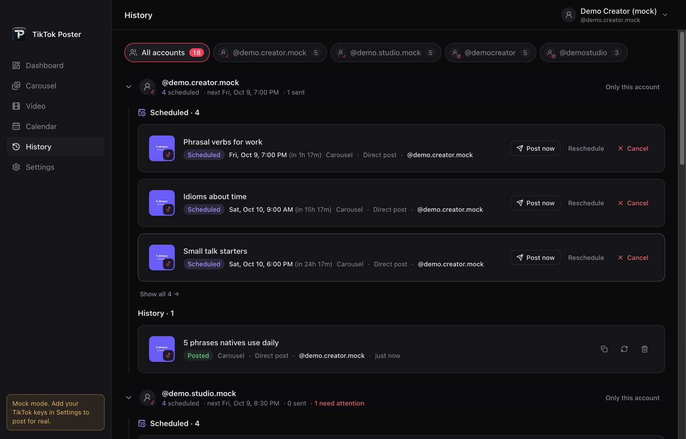

Click any post to see its slides, caption and details:

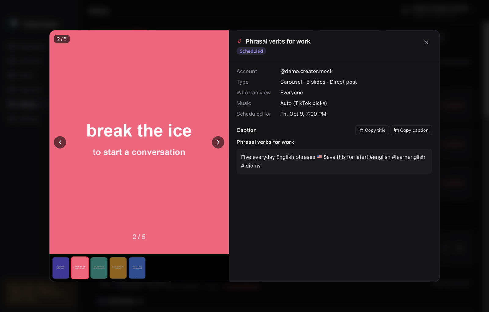

### Settings

Connect accounts, add a note to each one so you remember which login it uses, and enter your API keys.

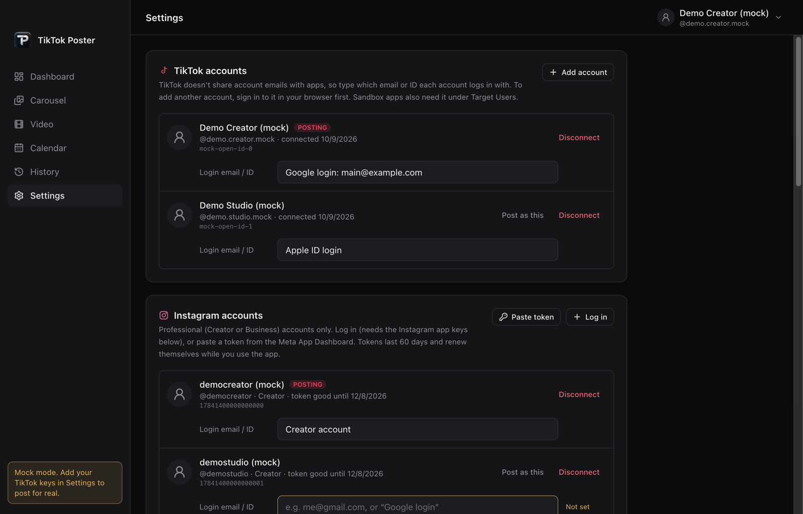

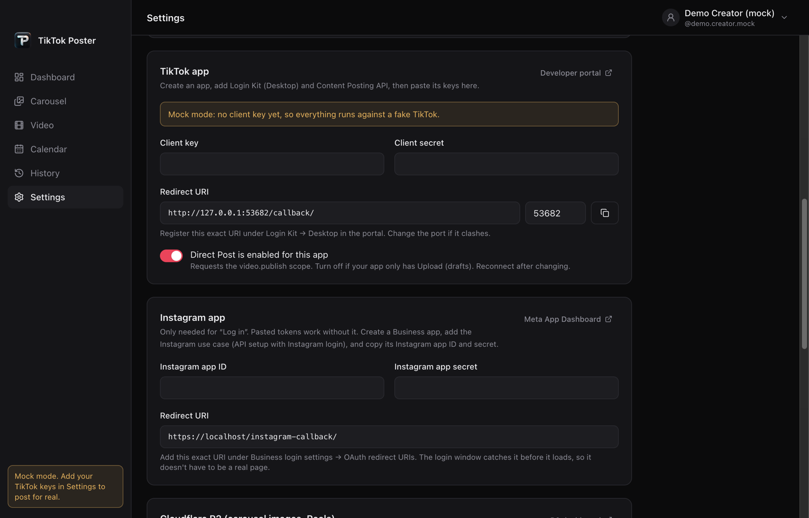

### Light mode

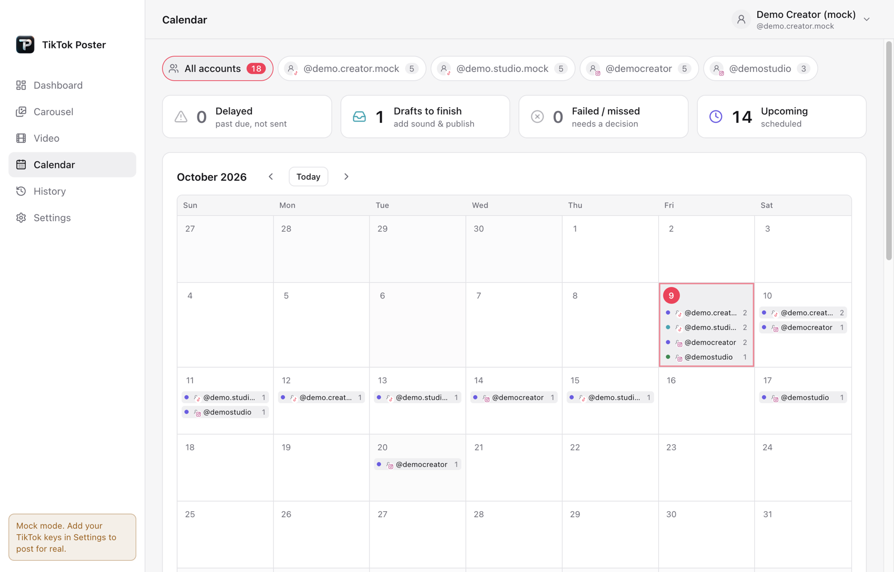

---

## Quick start: try it in 2 minutes (no keys needed)

### Requirements

| You need | Version | Check with |
| --- | --- | --- |
| macOS | any recent version | |
| [Node.js](https://nodejs.org/) | 22 or newer (20.19+ also works) | `node -v` |
| npm | comes with Node | `npm -v` |
| Git | any | `git --version` |

> The app is built and tested on macOS. It uses some macOS-only features, such as the system accent colour and Keychain-backed encryption. Windows and Linux are untested.

### Install and run

```bash
git clone https://github.com/abehan7/tiktok-poster.git
```

```bash
cd tiktok-poster
```

```bash
npm install
```

```bash
npm run dev
```

The app window opens with hot reloading. Because no TikTok key is set yet, it starts in **mock mode**, and the yellow note in the sidebar says so:

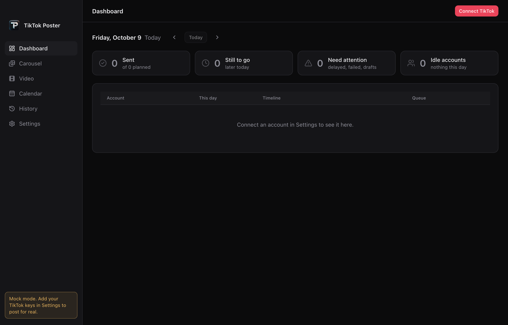

### What you can try in mock mode

Mock mode is a complete fake of TikTok and Instagram that runs inside the app. Nothing is posted anywhere.

1. Click **Connect TikTok** at the top right. A mock account is "signed in" right away. Click it again to add a second account.
2. Open **Settings → Instagram accounts → Paste token** and paste any text to add a mock Instagram account.
3. Open **Carousel**, add some images, and press **Post**. You'll see upload progress and status updates, the same as in the real flow.
4. Switch **When** to **Schedule** and pick a time a few minutes ahead. Watch it appear on the **Calendar**, then go out on time.

When you're ready to post for real, continue to the next section.

---

## Going live: connect real accounts

What you need depends on what you want to post:

| I want to post… | TikTok developer app | Cloudflare R2 bucket | Instagram setup |
| --- | :---: | :---: | :---: |
| TikTok videos | ✅ | | |
| TikTok photo carousels | ✅ | ✅ | |
| Instagram carousels or Reels | ✅ ¹ | ✅ | ✅ |

¹ Setting a TikTok client key is what turns off mock mode for the whole app.

**Why R2?** TikTok and Instagram don't let apps upload photos directly. Instead, they download each photo from a public HTTPS link (Instagram does the same for Reels). The app uploads your files to your own Cloudflare R2 bucket first, then gives TikTok or Instagram the link. Videos sent to TikTok are uploaded directly and don't need R2.

### 1. TikTok developer app

1. Go to **<https://developers.tiktok.com/apps>**, sign in, and **create an app**.
2. Add the **Login Kit** product. Under **Desktop**, add this redirect URI exactly as written:
   ```
   http://127.0.0.1:53682/callback/
   ```
   It's also shown in the app under **Settings → TikTok app → Redirect URI**, with a copy button. If port `53682` is already in use on your Mac, change the port in Settings and register the new URI instead.
3. Add the **Content Posting API** product.
   - Turn on **Direct Post** if you want to publish straight to your profile.
   - Without it, you can still use **Draft to inbox**. In that case, turn off *Direct Post is enabled for this app* in Settings.
4. Request these **scopes**: `user.info.basic`, `video.upload`, and `video.publish` (needed only for Direct Post).
5. **For carousels:** under **URL properties**, verify the domain (or URL prefix) of your R2 bucket. See [step 2](#2-cloudflare-r2-for-carousels-and-instagram).
6. While the app is in **Sandbox**, add each TikTok account you'll use under **Target Users**.
7. Copy the **Client key** and **Client secret** into **Settings → TikTok app**, then click **Save settings**. The yellow mock-mode note disappears.
8. Click **Add account** (or **Connect TikTok**). Your browser opens TikTok's login page. Approve access, and the account shows up in the app.

> **Tip: adding more accounts.** TikTok logs in whichever account your browser is currently signed in to. To add a second account, switch accounts in your browser first, then click **Add account** again.

> **Heads-up: unaudited apps post privately.** Until TikTok audits your app, every *Direct post* is forced to **Only me** (`SELF_ONLY`). **Draft to inbox** avoids this: the post goes to your TikTok inbox, and you publish it publicly from your phone.

### 2. Cloudflare R2 (for carousels and Instagram)

1. In the [Cloudflare dashboard](https://dash.cloudflare.com/), open **R2** and **create a bucket**, for example `social-media`.
2. Open the bucket's **Settings → Custom Domains** and connect a domain you own, for example `media.example.com`.
   TikTok will only pull images from a **verified custom domain** with no redirects. The default `r2.dev` URL won't work for TikTok.
3. Go to **R2 → Manage API tokens** and create a token with **Object Read & Write** access to that bucket. Note the **Access Key ID** and **Secret Access Key**.
4. In the app, open **Settings → Cloudflare R2** and fill in:

   | Field | Example |
   | --- | --- |
   | Account ID | your Cloudflare account ID, shown on the R2 overview page |
   | Bucket | `social-media` |
   | Access key ID / Secret access key | from step 3 |
   | Public base URL | `https://media.example.com` |
   | Key prefix | `tiktok/` (the folder the files go into) |

5. Click **Save & test R2**. The app uploads a small test file and checks that it can be read through your public URL.
6. Go back to the TikTok portal and verify `media.example.com` (or `https://media.example.com/tiktok/`) under **URL properties**.

Before uploading, images are converted to JPEG (at most 1080p, under 20 MB). They're stored at `<prefix>/<timestamp>-<id>/<n>.jpg`.

### 3. Instagram (optional)

Each composer has a **Post to** row where you choose TikTok, Instagram, or both.

> ⚠️ **Instagram has no drafts.** Instagram posts are published **publicly** the moment they're sent, or at the scheduled time.

**Requirements**

- The Instagram account must be a **professional** account (Creator or Business). You can switch to one in the Instagram app under *Settings → Account type and tools*.
- You need a **Meta developer app** with the Instagram use case. Go to <https://developers.facebook.com/apps>, create an app, and add the **Instagram** use case (**API setup with Instagram login**).
- **R2 must be set up** ([step 2](#2-cloudflare-r2-for-carousels-and-instagram)). Instagram doesn't need domain verification.

**Option A: paste a token (easiest, no app keys needed)**

1. In the Meta App Dashboard, open your app and go to **Instagram → API setup with Instagram login → Generate access tokens**.
2. Add your Instagram account and click **Generate token**.
3. In the app, open **Settings → Instagram accounts → Paste token** and paste it in.

**Option B: log in from the app**

1. Copy the **Instagram app ID** and **Instagram app secret** from the Meta dashboard into **Settings → Instagram app**.
2. In the Meta dashboard, add the redirect URI shown in Settings (`https://localhost/instagram-callback/` by default) under **Business login settings → OAuth redirect URIs**.
   The login runs in an app window that catches the redirect before it loads, so the URI doesn't need to be a real page.
3. Click **Log in** under *Instagram accounts*.

**Good to know**

- Tokens last 60 days. The app renews them automatically about once a week while you use it.
- Carousels can have up to **10** slides, and slide 1 is the cover. Slides taller than 4:5 (such as 1080×1440) are padded with thin side bars to 1080×1350, so nothing is cropped.
- Reels must be **MP4 or MOV**, **3 seconds to 15 minutes** long, and **300 MB or smaller**.

---

## Using the app

### Posting a carousel

1. Open **Carousel** (⌘1).
2. Click **Add images…** or drag images onto the window. PNG, JPG and WebP work, up to 35 images. Click a slide to make it the **cover**.
   - Or click **Load render folder…** and pick a folder. Numbered images (`1.png`, `2.png`…) become the slides, files starting with `_` are skipped, and `caption.txt` fills in the description.
3. Choose where to post (**TikTok**, **Instagram**, or both) and **when** (**Post now** or **Schedule**).
4. Choose the account under **Post as**.
5. Choose **Draft to inbox** or **Direct post**. For Direct post, also pick **Who can view**.
6. Write a title (up to 90 characters) and a description (up to 4,000 characters), then press **Post**.

### Posting a video

1. Open **Video** (⌘2) and drop in a video: MP4, MOV or WebM, up to 4 GB, 23–60 fps.
2. Scrub to the frame you want as the cover and click **Use current frame**.
3. Pick the destinations, account and mode as above, then press **Post**.

### Draft to inbox or Direct post?

| | Draft to inbox | Direct post |
| --- | --- | --- |
| Where it goes | The inbox in your TikTok app | Straight to your profile |
| You finish it | On your phone: add a sound, caption and privacy, then publish | Nothing more to do |
| Works before TikTok audits your app | ✅ posts publicly once you publish | ⚠️ forced to **Only me** |
| Needs the `video.publish` scope | No | Yes |

After you publish a draft on your phone, click **Mark published** in History or on the Dashboard. TikTok's API can't report when a draft has been published, so this keeps your counts accurate.

### Scheduling

- Switch **When** to **Schedule** and pick a date and time at least a minute ahead.
- Your files are **copied** when you schedule, so you can edit or delete the originals afterwards.
- **The app must be running** at the scheduled time. Closing the window is fine, but quitting stops the schedule. The app warns you before quitting if posts are pending, and turns off App Nap so timers aren't delayed. Your Mac still has to be awake, so if it goes to sleep, the post goes out once it wakes.
- If the app was closed when a post was due, it posts it as soon as you reopen the app (marked as *late*). Posts more than 12 hours overdue are marked **missed** instead, so you can decide whether to reschedule them.
- From History or the Calendar you can **Post now**, **Reschedule** or **Cancel** any scheduled post.

### Status colours

| Status | Meaning |
| --- | --- |
| 🟣 Scheduled | Waiting for its time |
| 🟠 Delayed | Past due but not sent yet (for example, the app was closed) |
| 🟡 Sending | Uploading, or TikTok/Instagram is still processing it |
| 🩵 Draft ready | In your TikTok inbox, waiting for you to finish it |
| 🟢 Published / posted | Done |
| 🔴 Failed / missed | Needs a decision. Open it to see why. |

### Keyboard shortcuts

| Shortcut | Action |
| --- | --- |
| ⌘0 | Dashboard |
| ⌘1 | New carousel |
| ⌘2 | New video |
| ⌘3 | Calendar |
| ⌘4 | History |
| ⌘, | Settings |
| ← / → / Esc | Browse slides or close the post detail view |

### Bulk scheduling (import folder)

To schedule many posts without using the UI, for example from a script:

1. While the app is running, write a manifest to
   `~/Library/Application Support/TikTok Poster/import/<name>.json`.
   Write it as `<name>.tmp` first and rename it to `.json` when it's complete, so the app never reads a half-written file.
2. Within 15 seconds, the app schedules every post in it using the normal checks. The posts appear in History and the Calendar.
3. The manifest moves to `import/done/`, next to a `<name>.result.json` that lists each post's entry ID or error.

Only Instagram videos are supported for now (see `src/main/posting/ImportInbox.ts`):

```json
{ "posts": [
  { "platform": "instagram", "kind": "video", "igUserId": "1784…", "filePath": "/abs/path/reel.mp4",
    "caption": "text #tags", "at": "2026-10-10T08:00:00-04:00", "shareToFeed": true }
] }
```

You can find the `igUserId` under each account in **Settings → Instagram accounts**.

---

## Build a standalone .app

```bash
npm run dist
```

This creates `dist/mac-arm64/TikTok Poster.app`. Drag it into **Applications**. To build the DMGs instead, run `npm run dist:dmg`.

Releases are built by GitHub Actions: pushing a tag like `v0.2.0` builds both DMGs and attaches them to a new GitHub Release (see `.github/workflows/release.yml`). Bump `version` in `package.json` first so the file names match.

The build isn't code-signed, so the first time you open it, macOS may say it can't verify the developer. **Right-click the app → Open → Open** once, or run:

```bash
xattr -dr com.apple.quarantine "/Applications/TikTok Poster.app"
```

---

## Where your data lives

Everything is stored locally in:

```
~/Library/Application Support/TikTok Poster/
├── settings.json      # app settings (secrets encrypted)
├── tokens.json        # TikTok tokens (encrypted)
├── instagram.json     # Instagram tokens (encrypted)
├── history.json       # every post and its status
├── schedules.json     # pending scheduled jobs
├── scheduled/<id>/    # copies of the files for scheduled posts
├── thumbs/            # small cover thumbnails for History
└── import/            # bulk-scheduling inbox
```

Secrets and tokens are encrypted with Electron [`safeStorage`](https://www.electronjs.org/docs/latest/api/safe-storage), which uses the macOS Keychain. To reset the app completely, quit it and delete this folder.

---

## Troubleshooting

<details>
<summary><b>My Direct posts show up as "Only me" / private</b></summary>

TikTok forces every Direct post from an **unaudited** app to private. Either submit your app for TikTok's audit, or use **Draft to inbox** and publish from your phone.
</details>

<details>
<summary><b>TikTok login says the redirect URI doesn't match</b></summary>

The URI registered under *Login Kit → Desktop* must match the one in **Settings → TikTok app** exactly, including the trailing `/` and the port.
</details>

<details>
<summary><b>"Address already in use" when connecting TikTok</b></summary>

Another program is using port 53682. Change the port in Settings, register the new redirect URI in the TikTok portal, and try again.
</details>

<details>
<summary><b>Carousel fails with a URL / domain verification error</b></summary>

TikTok only pulls images from a domain or URL prefix you've verified under **URL properties** in the TikTok portal. Make sure the **Public base URL** in Settings uses that exact domain, isn't an `r2.dev` URL, and doesn't redirect. Click **Save & test R2** to check the bucket.
</details>

<details>
<summary><b>A scheduled post didn't go out</b></summary>

The app has to be running at the scheduled time. Check the **Calendar** for *Delayed* or *Failed / missed* posts, then click **Post now** or **Reschedule**.
</details>

<details>
<summary><b>Instagram says the token expired</b></summary>

Tokens renew automatically while you use the app. If you haven't opened it for about 60 days, reconnect the account in **Settings → Instagram accounts**.
</details>

<details>
<summary><b>I only see one TikTok account even after clicking Add account twice</b></summary>

TikTok signs in whichever account your browser is logged into. Log out of TikTok in the browser (or switch accounts) before clicking **Add account** again. Sandbox apps also need each account listed under **Target Users**.
</details>

---

## How it works (for developers)

Built with **Electron**, **electron-vite**, **React 19**, **Tailwind CSS v4** and **TypeScript**. The main process does all the networking and file work. The renderer is a sandboxed React app that talks to it through a typed IPC contract.

```
src/
├── main/                     # Electron main process (Node)
│   ├── index.ts              # window, menu, startup wiring
│   ├── ipc.ts                # IPC handlers (one per PosterApi method)
│   ├── tiktok/               # OAuth, live + mock TikTok gateways, sessions
│   ├── instagram/            # login window, live + mock Graph API, sessions
│   ├── posting/              # posting services, scheduler, import inbox
│   ├── storage/ImageHost.ts  # R2 uploads (S3 API via aws4fetch)
│   └── store/                # JSON stores, encrypted secrets and tokens
├── preload/                  # exposes window.poster to the renderer
├── renderer/src/             # React UI: views/, components/, lib/
└── shared/contract.ts        # IPC types shared by main and renderer
```

| Piece | Where |
| --- | --- |
| OAuth: desktop Login Kit, PKCE with a hex SHA-256 challenge, one-shot loopback server | `src/main/tiktok/oauth.ts` |
| TikTok API (live and mock) | `src/main/tiktok/*Gateway.ts` |
| Token storage and refresh | `src/main/tiktok/TikTokSession.ts` |
| Video chunking, image conversion, R2 hosting, status polling | `src/main/posting/PostingService.ts` |
| R2 upload (S3 API through `aws4fetch`) | `src/main/storage/ImageHost.ts` |
| Instagram login window, Graph API (live and mock), token refresh | `src/main/instagram/*` |
| Instagram containers → publish, 4:5 padding | `src/main/posting/InstagramPostingService.ts` |
| Scheduling, file snapshots, late/missed handling | `src/main/posting/Scheduler.ts` |
| Bulk import folder | `src/main/posting/ImportInbox.ts` |
| IPC contract shared by main and renderer | `src/shared/contract.ts` |
| UI (React and Tailwind v4) | `src/renderer/src` |

### Scripts

| Command | What it does |
| --- | --- |
| `npm run dev` | Start the app with hot reloading |
| `npm run build` | Build the main, preload and renderer bundles into `out/` |
| `npm start` | Run the built app from `out/` |
| `npm run typecheck` | Type-check the main and renderer projects |
| `npm run dist` | Build an unsigned macOS `.app` into `dist/` |

### Mock mode internals

When `settings.clientKey` is empty, `TikTokSession` and `InstagramSession` use `MockTikTokGateway` and `MockInstagramGateway`, and R2 is replaced by `MockImageHost`. These fakes simulate login, chunked upload, processing delays and final statuses, so you can work on the UI without network access or real accounts.

---

## Contributing

Issues and pull requests are welcome.

1. Fork the repo and create a branch: `git checkout -b my-change`.
2. Make your change. Mock mode is the quickest way to test it.
3. Run `npm run typecheck`.
4. Open a pull request that explains what changed and why. Include a screenshot for UI changes.

---

## License

[MIT](LICENSE) © abehan7

---

## Disclaimer

This is an independent project. It is **not affiliated with, endorsed by, or sponsored by TikTok, ByteDance, Instagram, or Meta**. "TikTok" and "Instagram" are trademarks of their respective owners. You are responsible for following the [TikTok Developer Terms](https://www.tiktok.com/legal/page/global/tik-tok-developer-terms-of-service/en), the [Meta Platform Terms](https://developers.facebook.com/terms/), and each platform's content policies when you use this app.

**TikTok drafts and notifications:** an unaudited TikTok app can only send drafts to the account's TikTok inbox, so
each one has to be posted by hand in the TikTok app (and TikTok allows only about 5 waiting at once). When a scheduled
draft lands, TikTok Poster shows a macOS notification ("TikTok draft uploaded — time to post"). Click it to copy the
caption, then open TikTok → Inbox and post. A refused draft gets its own notification with the reason, and the Dock
badge counts drafts you haven't marked yet. After posting, click **Mark posted** in the History list, the calendar's
day list or the post detail. The status goes from **Draft uploaded** to **Posted**, with Undo. Instagram posts publish
on their own and don't notify (`src/main/posting/DraftNotifier.ts`).

The import manifest also takes TikTok drafts:
`{ "platform": "tiktok", "kind": "video", "account": "@handle", "filePath": "…", "caption": "…", "at": "…+09:00" }`.
History keeps its newest 500 entries but never drops a scheduled post or an unposted draft.
